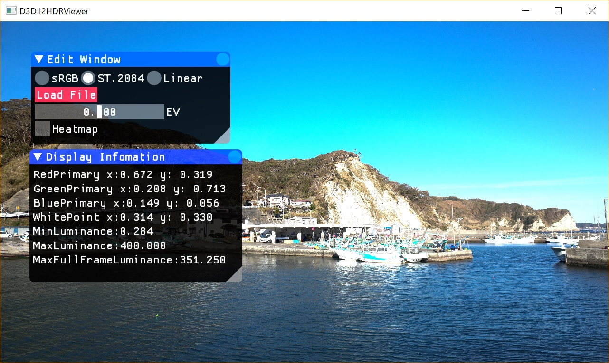
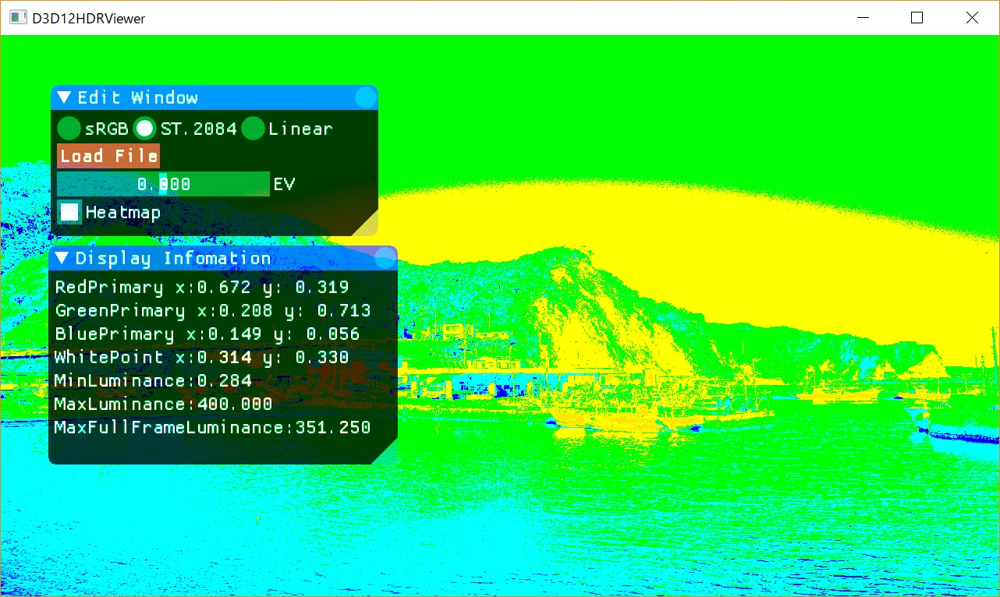
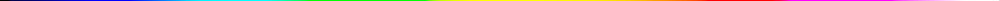

# HDRImageViewer

HDRImageViewer is a Direct3D 12 HDR image viewer for HDR10 displays on Windows.

Windows の HDR 表示に対応した HDR10 ディスプレイで、OpenEXR / DDS / JPEG XR 画像を表示するサンプルです。表示カーブは sRGB、ST.2084、Linear を切り替えられます。

## Screen Shots



ヒートマップモードでは、ST.2084 出力時に 0 nits から 10,000 nits の輝度に応じたヒートマップを表示できます。内部計算時の輝度分布を確認するための表示です。



ヒートマップのテーブルは下記です。左が 0 nits、右が 10,000 nits です。



ヒートマップについては下記の記事のテーブルを参考にしています。

https://www.resetera.com/threads/hdr-games-analysed.23587/

スクリーンキャプチャは sRGB に変換されています。

## Requirements

- Windows 10 / Windows 11
- Visual Studio 2022
- Windows 10 SDK または Windows 11 SDK
- `dxc.exe` を含む Windows SDK
- Direct3D 12 対応 GPU / ドライバー
- Shader Model 6.6 対応環境

## Building Sources

ソリューションは下記です。

```text
src\HDRImageViewer.sln
```

Release x64 または Debug x64 でビルドしてください。

現在のシェーダービルドは Visual Studio の `FxCompile` ではなく、Windows SDK の `dxc.exe` を使用します。プロジェクトの `CompileDxcShaders` ターゲットで Shader Model 6.6 の DXIL を生成し、従来と同じように `.hlsl.h` と `.cso` を出力します。

ThirdParty に入っているサブモジュール:

- DirectXTex: https://github.com/microsoft/DirectXTex
- imgui: https://github.com/ocornut/imgui

NuGet より取得するライブラリ:

- OpenEXR openexr-msvc14-x64: https://www.nuget.org/packages/openexr-msvc14-x64/
- zlib zlib-vc140-static-32_64: https://www.nuget.org/packages/zlib-vc140-static-32_64/

NuGet パッケージは Visual Studio の「ソリューションの NuGet パッケージの復元」で取得できます。

Release ビルド済みの実行ファイルは下記にあります。

```text
bin\D3D12HDRViewer.exe
```

## Runtime Notes

- ファイル選択には `IFileOpenDialog` を使用しています。
- 「ダウンロード」などの Known Folder からも OpenEXR / DDS / JPEG XR ファイルを選択できます。
- imgui は最新 backend に合わせ、DirectX 12 用 SRV descriptor allocator をアプリ側で渡しています。

## 操作方法


### imgui の Window

Window はマウスで画面内を移動したりサイズを変えたりできます。初期状態では Window が重なって表示される場合があります。

### Edit Window

- sRGB / ST.2084 / Linear: 色空間の変更。Linear は 16bit color で出力します。
- Load File: OpenEXR / DDS / JPEG XR ファイルの読み込み。
- EV: EV 値の変更。+8.0 から -8.0 まで。
- Heatmap: ST.2084 選択時に有効にすると、輝度に応じたヒートマップを表示します。

### Display Information

ディスプレイの輝度や、CIE 1931 上の色域の原色位置などを確認できます。

環境によっては正しい値が取得できない場合があります。

## キーボード操作

- PgUp / PgDn: 色空間の変更
- H: 10bit フォーマット時に ST.2084 と sRGB を切り替える
- U: GUI のオン / オフ。一度閉じた imgui Window を再表示する
- M: プリセットメタデータの変更
- Alt + Enter: フルスクリーン

## サンプルデータ

以下のリポジトリに OpenEXR 画像をいくつか公開しています。

https://github.com/shaderjp/OpenEXRSampleImages

サンプル画像については下記の記事に書いています。

http://masafumi.cocolog-nifty.com/masafumis_diary/2018/01/hdr10openexrhdr.html

## Todo

- ベースとなる Microsoft のサンプルコードから不要な処理を除去
- English documentation

## 既知の不具合

- フルスクリーン時にファイルを開こうとすると、環境によってダイアログ表示が不安定になる場合があります。
- HDR がオンの際に Linear を選択すると、imgui の輝度が高い状態になります。
